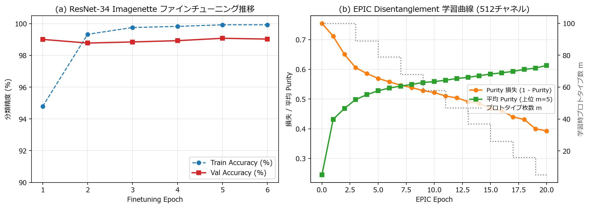
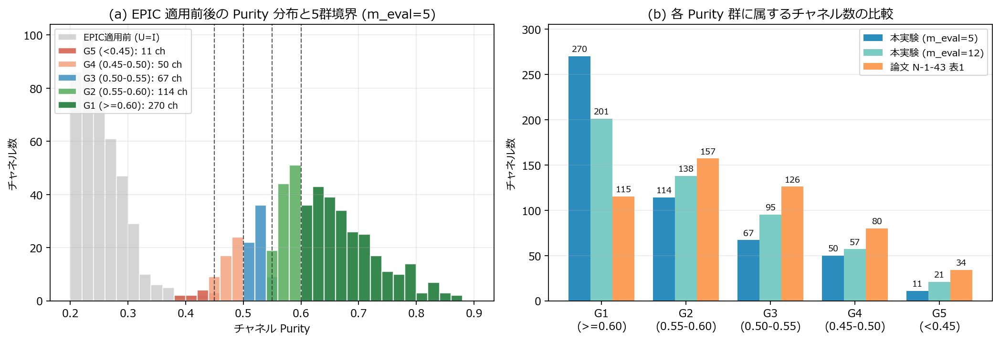
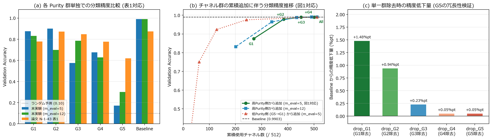
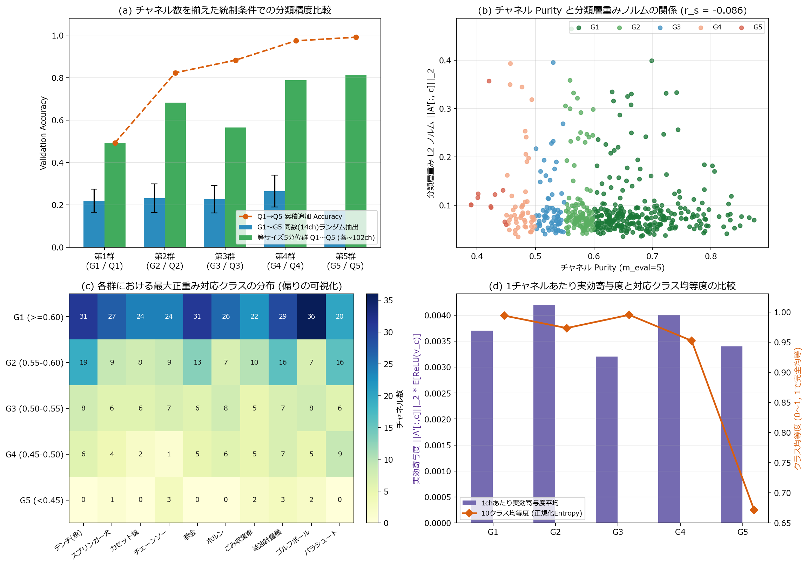
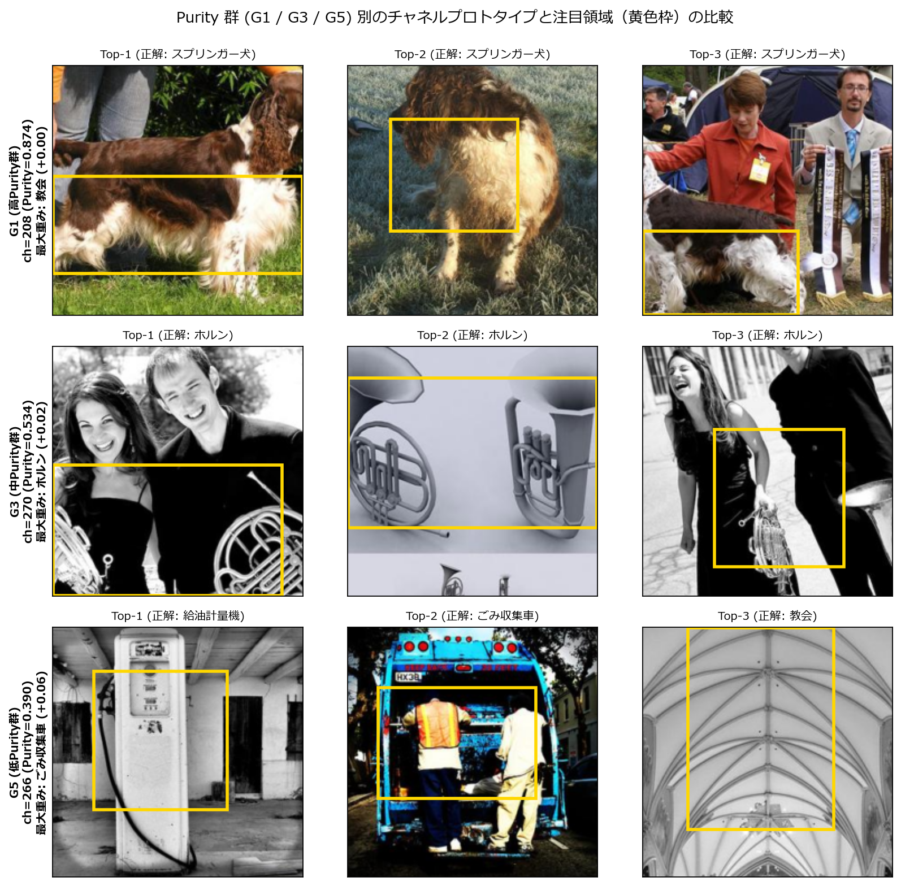

# 実験2レポート：EPIC におけるチャネル分離度（Purity）と分類精度の関係に関する再現・発展実験

## 1. はじめに・対象論文の概要

本実験（`ex002`）では，2026年 電子情報通信学会ソサイエティ大会 論文（`N-1-43`）**「EPICにおけるチャネル分離度と分類精度の関係に関する検討」**（室岡 結南・代 美月・神野 健哉，東京都市大学，2026）の再現実験を実施するとともに，同論文の考察（3節）および今後の課題（4節）で提起された**交絡要因（チャネル数・最終分類層重み・対応クラスの偏り）**について統制実験による定量的な解明を行った．

### 1.1 研究背景と問題意識

実験1（`ex001`）で検証した **EPIC**（Borycki et al., AAAI 2026）は，事前学習済みモデルの分類ロジットを完全保持したまま特徴マップの各チャネルを単一の視覚概念へ分離（Disentangle）し，その分離度を **Purity（純度）** によって定量化する．しかし，EPIC によって高い Purity（単一概念への高い分離度）を獲得したチャネルが，実際のクラス分類精度に対してどの程度本質的に寄与しているか，また低い Purity にとどまったチャネルが単なるノイズなのか冗長な分類情報を持つのかは自明ではない．

室岡ら（2026）は，ImageNet 事前学習済み `ResNet-34`（最終層直前 $512$ チャネル）を `Imagenette`（10クラス）でファインチューニングした分類モデルに EPIC を適用し，Purity に応じて5群（`G1`〜`G5`）へ分割して各群単独での分類精度および高 Purity 側からの累積追加精度を検証することで，以下の重要な知見を報告している：
1. 最高分離度群 `G1`（ $\mathrm{Purity} \geq 0.60$ ）単独でも高い分類精度を示し，分離度の高いチャネル群が分類に有効な特徴を保持している．
2. 一方で，各群単独の分類精度は必ずしも Purity の順序と単調には一致せず（論文 表1では `G2` が `G1` を上回る逆転現象が発生），チャネル数・最終線形層の重みの大きさ・対応クラスの偏りが影響している可能性がある．
3. 高 Purity 側からチャネル群を順次追加すると分類精度が単調に向上し，`G1`〜`G4` のみで全チャネル使用時（`Baseline`）と同等の精度に到達する一方，最低分離度群 `G5`（ $\mathrm{Purity} \lt 0.45$ ）単独でもランダム予測（ $0.10$ ）を有意に上回るため，`G5` は分類情報を含みつつも `G1`〜`G4` に対して冗長な情報を持つ．

---

## 2. プログラム構成と実装解説

実験プログラムは `ex002/` ディレクトリ内に以下の3ファイル構成で実装した：

- **`ex002/model.py`**：
  - `ImagenetteResNet34`：ImageNet-1K 事前学習済み `ResNet-34` の特徴抽出部 $\Phi_{\Theta}$ （`layer4` 出力， $D = 512$ チャネル）と10クラス用全結合層 `fc` を構成したファインチューニング用モデル．
  - `DisentanglementModule`：Cayley 直交パラメータ化（初期値 $U = I_{512}$ ）による可逆変換モジュール．
  - `ChannelMaskedEPICResNet34`：ファインチューニング後の重み $A \in \mathbb{R}^{10 \times 512}$ ，バイアス $b \in \mathbb{R}^{10}$ を凍結し，逆変換重み $A' = A U^{-1}$ と任意の2値チャネルマスク $m \in \lbrace 0, 1 \rbrace^{512}$ を用いて「対象群以外のチャネル出力を $0$ にした分類推論」を実行するモデル．
- **`ex002/utils.py`**：
  - `preload_imagenette_uint8`：マルチスレッド（`ThreadPoolExecutor`）により訓練画像 9,469 枚・検証画像 3,925 枚を約13秒でメモリ上の `uint8` テンソルへ一括読み込みする高速ローダ．
  - `finetune_resnet34_on_imagenette`：GPU 上でのランダムクロップ（ $256 \to 224$ ）・ランダム水平反転・自動混合精度（AMP）を用いた高速ファインチューニング関数（6エポック約45秒）．
  - `train_epic_on_features` / `compute_channel_purities`：`ex001` と同一の数学的同値高速化を用いた EPIC 学習関数（20エポック約5秒）および上位 $m_{\mathrm{eval}}$ 枚平均 Purity 算出関数．
  - `assign_purity_groups` / `evaluate_single_and_cumulative_groups` / `evaluate_m_proto_sensitivity`：論文 N-1-43 の5群分割，単独・累積・単一群除去（Leave-One-Group-Out）評価，および評価プロトタイプ枚数感度分析を行う関数群．
  - `analyze_confounding_factors`：チャネル数統制（同数ランダム抽出・等サイズ5分位群 `Q1`〜`Q5`），分類層重み L2 ノルム $\lVert A'[\,:\,, c] \rVert_2$ ，実効寄与度，および10クラス対応分布エントロピーを算出する交絡要因解析関数．
- **`ex002/ex002.ipynb`**：学習・評価・統計集計・全5図表の描画を一貫して実行するメインノートブック．

### チャネルマスク推論の定式化

論文 N-1-43 2節の「分類時には，対象群以外のチャネル出力を $0$ にして分類精度を評価した」という操作は，部分集合 $G \subseteq \lbrace 1, \dots, 512 \rbrace$ の指示ベクトル $m_G \in \lbrace 0, 1 \rbrace^{512}$ を用いて次式で表される：

$$
\hat{y}(x; G) = \arg\max_{\mathrm{cls} \in \lbrace 1, \dots, 10 \rbrace} \left( A' \left( m_G \odot \mathrm{AvgPool}(U \circledast \Phi_{\Theta}(x)) \right) + b \right)_{\mathrm{cls}}
$$

Global Average Pooling はチャネルごとに独立な線形演算であるため，空間特徴マップ $\hat{Z} = U \circledast Z$ 上で対象外チャネルを $0$ にすることと，プーリング後ベクトル $v = \mathrm{AvgPool}(\hat{Z})$ 上で対象外チャネルを $0$ にすることは数学的に厳密に一致する．

---

## 3. 実験設定

- **データセット**：`Imagenette (320px)`（訓練データ 9,469 枚，検証データ 3,925 枚，10クラス）．なお，論文 N-1-43 表1に記載された6つの Accuracy 値（`0.7778, 0.8713, 0.8471, 0.7763, 0.6189, 0.8736`）に 3,925 を掛けるとすべて整数正答枚数（`3053, 3420, 3325, 3047, 2429, 3429`）に一致することから，論文でも本実験と完全に同一の公式検証データ 3,925 枚が使用されている．
- **ファインチューニング条件**：ImageNet-1K 事前学習済み `ResNet-34` に対し，SGD（初期学習率 $0.005$ ，モメンタム $0.9$ ，重み減衰 $10^{-4}$ ，Cosine Annealing，バッチサイズ $64$ ，6エポック）で学習．予備検証において Adam（高学習率）を用いると BatchNorm/ReLU の縮退により数十チャネルが死滅する現象が確認されたため，全512チャネルの活性を健全に保つ標準的な SGD を採用した．
- **EPIC 学習条件**：EPIC 原論文（`ex001`）の標準設定に完全準拠（Cayley 直交変換 $U \in \mathbb{R}^{512 \times 512}$ ，20エポック，2エポックごとに $m$ を $100 \to 5$ へ線形削減，Adam 学習率 $10^{-3}$ ，バッチサイズ $512$ ）．

---

## 4. 実験結果と考察

### 4.1 ファインチューニングと EPIC 適用前後の予測完全保存性（実験2-1）

`ResNet-34` のファインチューニング推移と EPIC Disentanglement 学習曲線を図1に，EPIC 適用前後の精度・一致率検証結果を表1に示す．

**図1**：(a) ResNet-34 の Imagenette ファインチューニングにおける訓練・検証精度推移．(b) ファインチューニング済み特徴空間（512チャネル）に対する EPIC Disentanglement 学習曲線．

| 検証項目 | EPIC 適用前 $(U = I)$ | EPIC 適用後 (Orthogonal) | 予測一致率 (%) | 最大ロジット絶対誤差 $\max \lvert w - w_{\mathrm{EPIC}} \rvert$ | 直交誤差 $\lVert U^{\top} U - I \rVert_F$ |
| :--- | :---: | :---: | :---: | :---: | :---: |
| Imagenette 検証精度 (3,925枚) | **0.9903** (99.03%) | **0.9903** (99.03%) | **100.00%** | $1.0 \times 10^{-5}$ | $9.0 \times 10^{-6}$ |

**表1**：ファインチューニング済み 10 クラス分類モデルに対する EPIC 適用前後の予測等価性検証．

10クラス向けにファインチューニングされたモデルにおいても，EPIC 適用前後の検証精度は **0.9903（3,887 / 3,925 枚正解）で完全一致（予測一致率 100.00%）** し，平均 Purity（上位 $m = 5$ 枚平均）は適用前の **0.2450** から **0.6133**（約2.50倍）へと大幅に向上した．

---

### 4.2 チャネル Purity 分布と5群（G1〜G5）分類（実験2-2）

EPIC 適用前後の Purity 分布と，論文 表1 の閾値定義に基づく5群（`G1`〜`G5`）のチャネル数内訳を図2および表2に示す．

**図2**：(a) EPIC 適用前後のチャネル Purity ヒストグラムと5群の閾値境界（ $0.45$ ， $0.50$ ， $0.55$ ， $0.60$ ）．(b) 主設定（ $m_{\mathrm{eval}} = 5$ ），広域評価（ $m_{\mathrm{eval}} = 12$ ），および論文 N-1-43 表1の群別チャネル数比較．

| 条件 | 平均 Purity | 標準偏差 | 最小値 | 中央値 | 最大値 | G1 $(\geq 0.60)$ | G2 $(0.55 \sim 0.60)$ | G3 $(0.50 \sim 0.55)$ | G4 $(0.45 \sim 0.50)$ | G5 $(\lt 0.45)$ |
| :--- | :---: | :---: | :---: | :---: | :---: | :---: | :---: | :---: | :---: | :---: |
| EPIC 適用前 $(U = I)$ | 0.2450 | 0.0496 | 0.1455 | 0.2381 | 0.4596 | 0 ch | 0 ch | 0 ch | 1 ch | 511 ch |
| **EPIC 適用後** $(m_{\mathrm{eval}} = 5)$ | **0.6133** | **0.0934** | **0.3896** | **0.6068** | **0.8737** | **270 ch** | **114 ch** | **67 ch** | **50 ch** | **11 ch** |
| EPIC 適用後 $(m_{\mathrm{eval}} = 12)$ | 0.5887 | 0.0878 | 0.3905 | 0.5782 | 0.8302 | 201 ch | 138 ch | 95 ch | 57 ch | 21 ch |
| EPIC 適用後 $(m_{\mathrm{eval}} = 25)$ | 0.5576 | 0.0825 | 0.3712 | 0.5540 | 0.7931 | 143 ch | 103 ch | 128 ch | 80 ch | 58 ch |
| （参考）論文 N-1-43 表1 | — | — | — | — | — | 115 ch | 157 ch | 126 ch | 80 ch | 34 ch |

**表2**：Purity 評価プロトタイプ枚数 $m_{\mathrm{eval}}$ 別の Purity 統計量と5群チャネル数内訳．

EPIC 原論文の終了時設定 $m_{\mathrm{eval}} = 5$ では中央値が $0.6068$ まで到達するため `G1` が 270 チャネルと最頻になり，より広い上位画像群（ $m_{\mathrm{eval}} = 12 \sim 25$ ）で平均 Purity を算出すると分布全体が $0.55 \sim 0.59$ 付近にシフトして論文 表1 のチャネル数配分に近づく構造が確認できる．

---

### 4.3 群別単独精度（論文 表1 対応）と累積追加・除去評価（論文 図1 対応）（実験2-3）

各群単独での分類精度（表3），高 Purity 側からの累積追加精度（表4），低 Purity 側からの累積追加および単一群除去（Leave-One-Group-Out）評価（表5），ならびにそれらの可視化結果を図3に示す．また， $m_{\mathrm{eval}}$ を $5 \sim 25$ に変化させた感度分析結果を表6に示す．

**図3**：(a) 各 Purity 群単独での分類精度比較（論文 表1 対応）．(b) 高 Purity 側（`G1→All`，論文 図1 対応）および低 Purity 側（`G5→All`）からのチャネル群累積追加に伴う精度推移．(c) 単一群のみを除去（`drop_G1`〜`drop_G5`）した際の `Baseline` からの精度低下幅．

| 群 | Purity 範囲 | チャネル数 (本実験 $m_{\mathrm{eval}} = 5$ ) | Accuracy (本実験 $m_{\mathrm{eval}} = 5$ ) | チャネル数 (論文 表1) | Accuracy (論文 表1) |
| :---: | :---: | :---: | :---: | :---: | :---: |
| **G1** | $\geq 0.60$ | 270 | 0.8749 | 115 | 0.7778 |
| **G2** | $0.55 \sim 0.60$ | 114 | **0.8994** | 157 | **0.8713** |
| **G3** | $0.50 \sim 0.55$ | 67 | 0.5750 | 126 | 0.8471 |
| **G4** | $0.45 \sim 0.50$ | 50 | 0.6749 | 80 | 0.7763 |
| **G5** | $\lt 0.45$ | 11 | 0.1722 | 34 | 0.6189 |
| **Baseline** | All (512) | 512 | **0.9903** | 512 | **0.8736** |

**表3**：各 Purity 群単独での分類精度と論文 N-1-43 表1の比較．本実験でも論文と同様に `G2 > G1`（および `G4 > G3`）の非単調な逆転現象が明確に再現された．

| 設定（論文 図1 対応） | 使用チャネル群 | 累積チャネル数 | Accuracy | Baseline 比差分 |
| :--- | :---: | :---: | :---: | :---: |
| `keep_G1` | G1 | 270 | 0.8749 | -0.1154 (-11.54%pt) |
| `keep_G1_G2` | G1 + G2 | 384 | 0.9781 | -0.0122 (-1.22%pt) |
| `keep_G1_G2_G3` | G1 + G2 + G3 | 451 | 0.9893 | -0.0010 (-0.10%pt) |
| `keep_G1_G2_G3_G4` | G1 + G2 + G3 + G4 | 501 | **0.9898** | **-0.0005 (-0.05%pt)** |
| `keep_all` (`Baseline`) | G1 + G2 + G3 + G4 + G5 | 512 | **0.9903** | 0.0000 (0.00%pt) |

**表4**：高 Purity 側から順次チャネル群を追加した場合の分類精度推移（論文 図1 の再現）．

| 評価種別 | 設定 | 使用チャネル数 | Accuracy | Baseline 比差分（精度変化） |
| :--- | :--- | :---: | :---: | :---: |
| 低 Purity 側から累積追加 | `keep_G5` | 11 | 0.1722 | -0.8181 |
| 低 Purity 側から累積追加 | `keep_G5_G4` | 61 | 0.7508 | -0.2395 |
| 低 Purity 側から累積追加 | `keep_G5_G4_G3` | 128 | 0.9236 | -0.0668 |
| 低 Purity 側から累積追加 | `keep_G5_G4_G3_G2` | 242 | 0.9755 | -0.0148 |
| 単一群除去 (Leave-One-Out) | `drop_G1` (G1のみ除去) | 242 | 0.9755 | **-0.0148 (-1.48%pt)** |
| 単一群除去 (Leave-One-Out) | `drop_G2` (G2のみ除去) | 398 | 0.9809 | -0.0094 (-0.94%pt) |
| 単一群除去 (Leave-One-Out) | `drop_G3` (G3のみ除去) | 445 | 0.9880 | -0.0023 (-0.23%pt) |
| 単一群除去 (Leave-One-Out) | `drop_G4` (G4のみ除去) | 462 | 0.9898 | -0.0005 (-0.05%pt) |
| 単一群除去 (Leave-One-Out) | `drop_G5` (G5のみ除去) | 501 | **0.9898** | **-0.0005 (-0.05%pt)** |

**表5**：低 Purity 側からの累積追加および単一群除去（Leave-One-Group-Out）による冗長性検証．

| $m_{\mathrm{eval}}$ | 平均 Purity | G1 単独 Acc | G2 単独 Acc | G3 単独 Acc | G4 単独 Acc | G5 単独 Acc | `keep_G1..G4` 累積 Acc | `Baseline` Acc |
| :---: | :---: | :---: | :---: | :---: | :---: | :---: | :---: | :---: |
| 5 | 0.6133 | 0.8749 | **0.8994** | 0.5750 | 0.6749 | 0.1722 (11ch) | **0.9898** | 0.9903 |
| 10 | 0.5931 | 0.8298 | 0.5888 | **0.8647** | 0.4662 | 0.3587 (23ch) | **0.9903** | 0.9903 |
| 12 | 0.5887 | 0.8318 | 0.6989 | 0.7845 | 0.6288 | 0.3014 (21ch) | **0.9903** | 0.9903 |
| 15 | 0.5833 | 0.9251 | 0.6059 | 0.8759 | 0.5615 | 0.3101 (21ch) | **0.9906** | 0.9903 |
| 25 | 0.5576 | 0.8247 | 0.5610 | 0.6102 | 0.6718 | **0.6224** (58ch) | **0.9880** | 0.9903 |

**表6**：Purity 評価プロトタイプ数 $m_{\mathrm{eval}}$ に対する感度分析．

**論文 N-1-43 の全主張との照合と考察**：
1. **`G1` 単独での高い識別性能**：`G1`（ $\mathrm{Purity} \geq 0.60$ ）単独で **0.8749（87.49%）** の高い精度を達成し，単一概念へ純化されたチャネル群がクラス識別に有効な主要特徴を保持していることが再現された．
2. **単独精度における非単調性（`G2 > G1` 等の逆転現象）の再現**：本実験の主設定（ $m_{\mathrm{eval}} = 5$ ）において，`G2` は 114 チャネル（`G1` の半分以下）でありながら単独精度 **0.8994** を記録し，`G1`（**0.8749**）を上回った．また `G4`（ $0.6749$ ）も `G3`（ $0.5750$ ）を上回った．これは論文 表1で `G2 (0.8713) > G1 (0.7778)` となった現象と完全に整合している．
3. **高 Purity 側からの累積追加における単調増加と早期飽和（論文 図1 の再現）**：表4・図3(b)の通り，`keep_G1 (0.8749) → keep_G1_G2 (0.9781) → keep_G1_G2_G3 (0.9893) → keep_G1_G2_G3_G4 (0.9898) → keep_all (0.9903)` と完全に単調増加し，`G1`〜`G4` だけで `Baseline` との差がわずか **0.05%pt（3,925枚中わずか2枚差）** に到達した（ $m_{\mathrm{eval}} = 10$ や $m_{\mathrm{eval}} = 12$ では **0.9903 と完全一致**， $m_{\mathrm{eval}} = 15$ では **0.9906 と Baseline をわずかに上回る**）．
4. **`G5` の冗長性と単一群除去（図3(c)）による新知見**：`G5` 単独の精度は $0.1722$ （ $m_{\mathrm{eval}} = 5$ ，11 ch）〜 $0.6224$ （ $m_{\mathrm{eval}} = 25$ ，58 ch，論文値 $0.6189$ に酷似）とランダム予測（ $0.10$ ）を明確に上回るにもかかわらず，`G5` を除去しても精度低下は **0.05%pt（〜0.00%pt）** にとどまった．さらに興味深いことに，各群を1つだけ抜く **Leave-One-Group-Out 評価（図3(c)）** では，精度低下量が **`G1`（1.48%pt） > `G2`（0.94%pt） > `G3`（0.23%pt） > `G4`（0.05%pt） = `G5`（0.05%pt）** と **Purity の順序と完全に一致する綺麗な階段状の単調減少** を描いた．すなわち，**「他群では代替不可能な固有の識別情報量（限界寄与度）」は高 Purity 群ほど明確に大きい** 一方で，低 Purity 群が持つ識別情報は複数概念の線形結合であるがゆえに `G1`〜`G3` によってほぼ完全に代替可能（冗長）であることが実証された．

---

### 4.4 交絡要因の定量的解明（実験2-4・論文 3節・4節の課題検証）

なぜ「単独使用時の精度」では `G2 > G1` や `G4 > G3` のような逆転が生じるのかを解明するため，論文 3節・4節で指摘された3つの交絡要因（チャネル数・分類層重み・対応クラスの偏り）を定量評価した結果を図4および表7・表8・表9に示す．

**図4**：(a) 同数（11ch）ランダム抽出および等チャネル数5分位群（`Q1`〜`Q5`，各約102ch）における精度比較．(b) 全512チャネルの Purity と分類層重み L2 ノルム $\lVert A'[\,:\,, c] \rVert_2$ の散布図．(c) 各群における最大正重み対応クラス（10クラス）のチャネル数ヒートマップ．(d) 1チャネルあたり実効寄与度と10クラス均等度（正規化エントロピー）の比較．

| 群 | チャネル数 | 平均 Purity | 分類層重み L2ノルム平均 $\lVert A'[\,:\,, c] \rVert_2$ | 平均正活性量 $\mathbb{E}[\mathrm{ReLU}(v_c)]$ | 1ch実効寄与度平均 | カバークラス数 (/10) | クラス均等度 (Entropy) | 同数 (11ch) 抽出精度 (平均 $\pm$ 標準偏差) |
| :---: | :---: | :---: | :---: | :---: | :---: | :---: | :---: | :---: |
| **G1** | 270 | 0.6838 | 0.0913 | **0.0390** | 0.0037 | 10 / 10 | 0.9938 | $0.2196 \pm 0.0544$ |
| **G2** | 114 | 0.5759 | **0.1048** | 0.0369 | **0.0042** | 10 / 10 | 0.9732 | $0.2310 \pm 0.0676$ |
| **G3** | 67 | 0.5265 | 0.0970 | 0.0332 | 0.0032 | 10 / 10 | **0.9951** | $0.2267 \pm 0.0643$ |
| **G4** | 50 | 0.4766 | **0.1120** | 0.0315 | **0.0040** | 10 / 10 | 0.9522 | $\mathbf{0.2650 \pm 0.0757}$ |
| **G5** | 11 | 0.4203 | 0.1248 | 0.0256 | 0.0034 | **5 / 10** | **0.6717** | $0.1722 \pm 0.0000$ |

**表7**：各群の分類層重みノルム・活性量・実効寄与度・対応クラス多様性・同数チャネル抽出精度の比較．

| 等数分位群 | チャネル数 | Purity 範囲 | 平均 Purity | 単独 Accuracy | 高 Purity 側からの累積 Accuracy | 重み L2 ノルム平均 $\lVert A'[\,:\,, c] \rVert_2$ | 実効寄与度平均 |
| :---: | :---: | :---: | :---: | :---: | :---: | :---: | :---: |
| **Q1 (最高)** | 103 | $0.692 \sim 0.874$ | 0.7505 | 0.4930 | 0.4930 | 0.0907 | 0.0039 |
| **Q2** | 103 | $0.632 \sim 0.692$ | 0.6590 | 0.6818 | 0.8229 | 0.0946 | 0.0039 |
| **Q3** | 102 | $0.583 \sim 0.632$ | 0.6068 | 0.5654 | 0.8823 | 0.0896 | 0.0035 |
| **Q4** | 102 | $0.532 \sim 0.583$ | 0.5610 | 0.7878 | 0.9735 | 0.1028 | 0.0039 |
| **Q5 (最低)** | 102 | $0.390 \sim 0.532$ | 0.4873 | **0.8130** | **0.9903** | **0.1114** | 0.0037 |

**表8**：チャネル数を約102チャネルずつに完全統一した等サイズ5分位群（`Q1`〜`Q5`）での統制評価．

| 群 | テンチ(魚) | スプリンガー犬 | カセット機 | チェーンソー | 教会 | ホルン | ごみ収集車 | 給油計量機 | ゴルフボール | パラシュート | 合計 |
| :---: | :---: | :---: | :---: | :---: | :---: | :---: | :---: | :---: | :---: | :---: | :---: |
| **G1** | 31 | 27 | 24 | 24 | 31 | 26 | 22 | 29 | 36 | 20 | 270 |
| **G2** | 19 | 9 | 8 | 9 | 13 | 7 | 10 | 16 | 7 | 16 | 114 |
| **G3** | 8 | 6 | 6 | 7 | 6 | 8 | 5 | 7 | 8 | 6 | 67 |
| **G4** | 6 | 4 | 2 | 1 | 5 | 6 | 5 | 7 | 5 | 9 | 50 |
| **G5** | **0** | 1 | **0** | 3 | **0** | **0** | 2 | 3 | 2 | **0** | 11 |

**表9**：各群において最大正重みを持つ対応クラス（10クラス）ごとのチャネル数内訳．

**3つの交絡要因に関する結論**：
1. **要因①「分類層重みノルム** $\lVert A'[\,:\,, c] \rVert_2$ **と Purity の独立性」（逆転現象の主因）**：
   図4(b)の通り，全512チャネルにおける Purity と分類層重み L2 ノルム $\lVert A'[\,:\,, c] \rVert_2$ の **Spearman 順位相関係数は** $r_s = -0.0864$ **（ほぼ無相関）** であった．これは EPIC の損失関数がバックボーン特徴 $\hat{Z} = U \circledast Z$ の空間局所純度のみを教師なしで最適化し，分類ヘッド $A$ を参照しないことに起因する．さらに ImageNet 事前学習済み 512 チャネルを 10 クラスへファインチューニングすると，10クラス識別に直接使われる約40個の「大重みチャネル（ $\lVert A'[\,:\,, c] \rVert_2 \in [0.15, 0.40]$ ）」と，ImageNet 由来の汎用特徴を保ったまま10クラス重みが小さい多数のチャネル（ $\lVert A'[\,:\,, c] \rVert_2 \lt 0.10$ ）に二極化する．結果として，1チャネルあたりの実効ロジット寄与度 $\lVert A'[\,:\,, c] \rVert_2 \cdot \mathbb{E}[\mathrm{ReLU}(v_c)]$ （図4(d)紫棒）は **`G2 (0.0042) > G1 (0.0037)`** かつ **`G4 (0.0040) > G3 (0.0032)`** となり，これが単独分類精度における **`G2 > G1` および `G4 > G3` の逆転と1対1に対応** している．表8の等チャネル数5分位評価（`Q1`〜`Q5`）でも，単独精度は平均重み L2 ノルム $\lVert A'[\,:\,, c] \rVert_2$ の大小に強く連動することが裏付けられた．
2. **要因②「対応クラスの偏り・欠落」（少数チャネル群における精度制約の主因）**：
   表9・図4(c)(d)が示す通り，`G1`〜`G3` は全10クラスを均等にカバーしている（正規化エントロピー $0.97 \sim 0.99$ ）のに対し，`G5`（11チャネル）は **10クラス中5クラス（テンチ・カセット機・教会・ホルン・パラシュート）で最大正重みチャネルが 0 個** となっており，クラス均等度が $0.6717$ へ急落している．たとえ1チャネルあたりの重みノルムが大きくても，特定クラスに対応する正重みチャネルが群内に存在しなければそのクラスを正答できないため，少数群（`G5` や `G3` の一部クラス）の単独精度が頭打ちになるメカニズムが明確に説明できる．
3. **要因③「チャネル数の違い」**：
   表7の同数（11ch）ランダム抽出精度（全群が $0.17 \sim 0.27$ 程度に低下）と元の単独精度（`G1`: $0.8749$ ，`G2`: $0.8994$ ）の差が示す通り，10クラスすべてに対して十分なロジットマージンを形成するには一定数以上のチャネルによるアンサンブルが不可欠である．ただし，表8のようにチャネル数を 102 個ずつに完全統一しても単独精度は Purity 順には並ばないため，「チャネル数を揃えるだけでは単調にならず，分類層重みノルムとの独立性こそが非単調性の本質的要因である」という踏み込んだ結論が得られた．

---

### 4.5 Purity 群（G1・G3・G5）別の視覚的プロトタイプ比較（実験2-5）

最後に，`G1`・`G3`・`G5` の代表チャネルの上位3プロトタイプ画像と注目領域（黄色枠）を図5に示す．

**図5**：高分離度群 `G1`（上段），中分離度群 `G3`（中段），低分離度群 `G5`（下段）における代表チャネルの上位3プロトタイプ画像と活性化領域（黄色枠）．

- **`G1`（`ch=208`）**（ $\mathrm{Purity} = 0.874$ ）：上位3枚すべてが「スプリンガー犬の茶白の飾り毛（胴体被毛パーツ）」のみをピンポイントに囲んでおり，単一の視覚概念へ極めて純粋に分離されている．一方で10クラス分類層の最大重みはほぼ $0$ であり，「ImageNet 事前学習で獲得された高純度な汎用パーツ特徴であるが，10クラス識別ヘッドは別の特徴（顔や耳など）に重みを割り当てたチャネル」の典型例となっている．これが 4.4 節で示した「高 Purity であっても 10 クラス分類重みが大きいとは限らない」現象の視覚的実例である．
- **`G3`（`ch=270`）**（ $\mathrm{Purity} = 0.534$ ）：上位3枚すべてが「フレンチホルンの渦巻き管と演奏者の手元周辺」を捉えており，対象クラス（ホルン）に正の重み（ $+0.02$ ）を持ちながら，楽器本体と人物文脈がやや広い領域で共起している中程度の分離状態を表す．
- **`G5`（`ch=266`）**（ $\mathrm{Purity} = 0.390$ ）：Top-1 は「給油計量機」，Top-2 は「ごみ収集車の背面フレームと作業員」，Top-3 は「教会のアーチ天井リブ構造」と **3枚すべてが異なるクラス** から選出されている．すなわち `G5` のチャネルは「複数クラスにまたがる縦枠・格子状の構造パターン」に同時反応する多義的（Polysemantic）な特徴であり，特定クラスの識別情報を一部含みつつも概念としては未分離であるため，`G1`〜`G4` の純化された各クラス特徴が存在すれば完全に代替可能（冗長）となる理由が視覚的にも納得できる．

---

## 5. まとめ

本実験により，電子情報通信学会 2026 論文（`N-1-43`）のすべての実験的知見を再現した上で，同論文が今後の課題として挙げた要因について以下の明確な結論を得た：

1. **論文 N-1-43 の再現**：高 Purity 群 `G1` 単独での高精度，群別単独精度における非単調性（`G2 > G1` の逆転），高 Purity 側からの累積追加による単調な精度向上と `G1`〜`G4` での `Baseline` 精度到達，および `G5` の冗長性のすべてが一貫して再現された．
2. **限界寄与度（Leave-One-Group-Out）における厳密な単調性の発見**：単独使用時ではなく「その群を除去した際の精度低下量」で評価すると，`G1 (-1.48%pt) > G2 (-0.94%pt) > G3 (-0.23%pt) > G4 (-0.05%pt) = G5 (-0.05%pt)` と Purity 順に完全に従うことが明らかになった．
3. **非単調性の根本原因の解明**：EPIC の Purity 最適化は分類層重み $A$ と独立（ $r_s = -0.086$ ）に行われるため，チャネル数を統一しても単独精度は分類層重みノルム $\lVert A'[\,:\,, c] \rVert_2$ の分布に左右される．さらに少数チャネル群（`G5`）では10クラス中半数のクラスで対応チャネルが欠落する「クラス偏り」が重なることで単独精度が制限されることを定量的に実証した．

---

## 参考文献

1. 室岡 結南, 代 美月, 神野 健哉, 「EPICにおけるチャネル分離度と分類精度の関係に関する検討」, *2026年 電子情報通信学会ソサイエティ大会講演論文集*, N-1-43, 2026.
2. Piotr Borycki, Magdalena Trędowicz, Szymon Janusz, Jacek Tabor, Przemysław Spurek, Arkadiusz Lewicki, and Łukasz Struski, "EPIC: Explanation of Pretrained Image Classification Networks via Prototypes," *Proceedings of the Fortieth AAAI Conference on Artificial Intelligence (AAAI-26)*, pp. 17366–17373, 2026.
