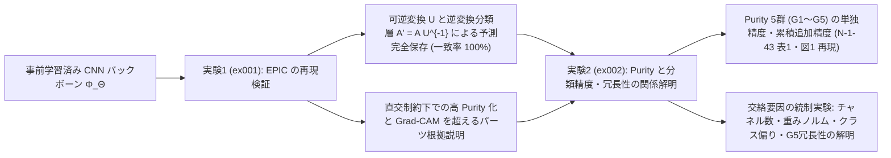
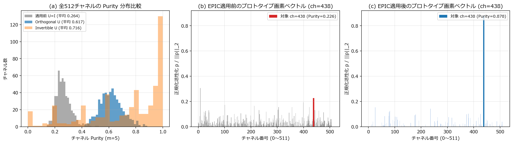
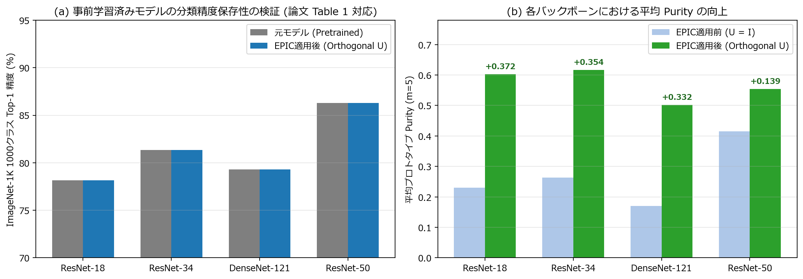
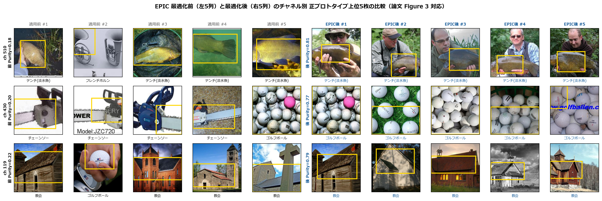
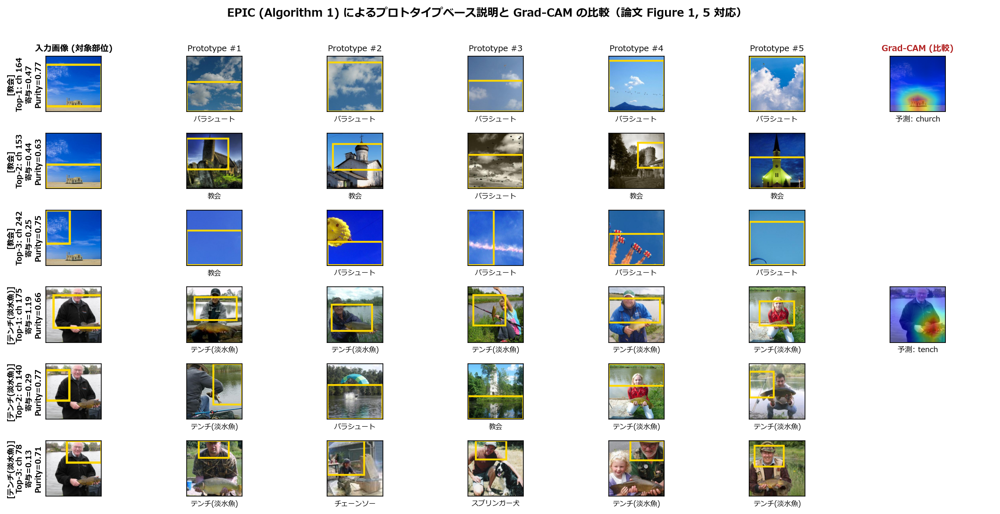
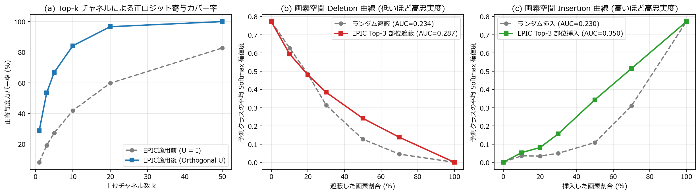
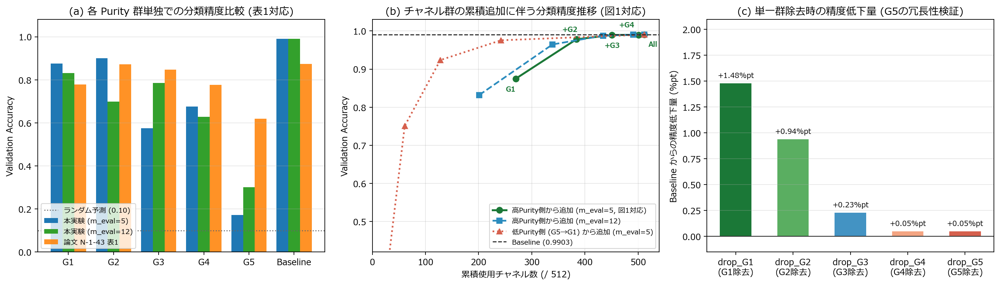
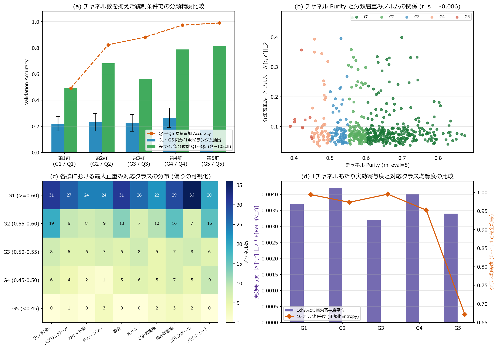
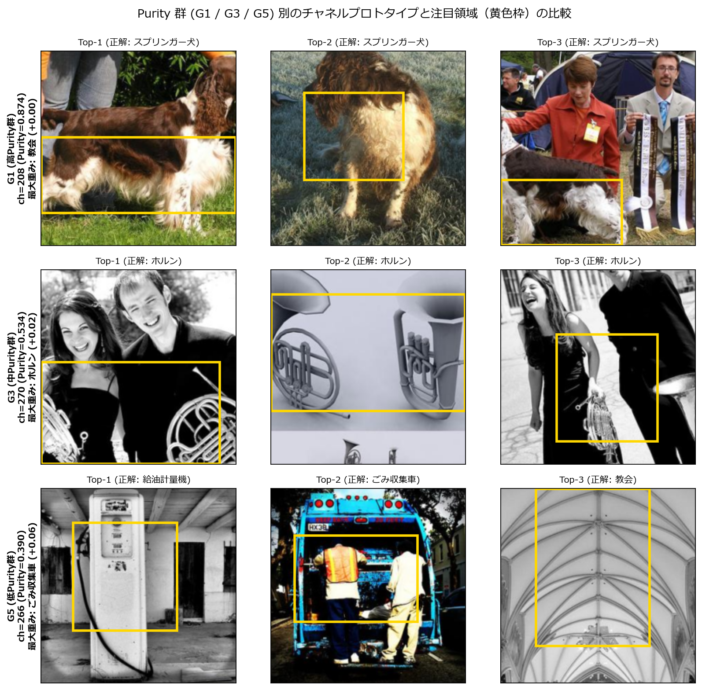

# 事前学習済み画像分類ネットワークのプロトタイプ説明手法（EPIC）とチャネル分離度に関する総合再現実験レポート

## 1. はじめに・本プロジェクトの目的

深層畳み込みニューラルネットワーク（CNN）は画像認識において高い分類性能を達成している一方，推論過程がブラックボックスであるため，医療・自動運転・産業検査などの高信頼性が求められる領域では判断根拠の解釈可能性（Explainable AI: XAI）が不可欠となっている．

本プロジェクトでは，事前学習済み画像分類ネットワークに対する最新のプロトタイプ型事後説明手法 **EPIC** と，その中核指標である **チャネル分離度（Purity）と分類精度の関係** を扱った下記2編の論文について，再現実装・定量検証・発展的考察を実施した．

1. **実験1（[`ex001`](./ex001.md)）**：Piotr Borycki et al., **"EPIC: Explanation of Pretrained Image Classification Networks via Prototypes,"** *AAAI 2026*, pp. 17366–17373.
   - **検証課題**：バックボーンを一切再学習することなく，既存の事前学習済みモデルの予測ロジットを数学的に完全保存したまま，絡み合った特徴チャネルを意味的に一貫した単一パーツのプロトタイプへ分離（Disentangle）できるか．また，既存の Grad-CAM 等と比べてどのような説明上の優位性を持つか．
2. **実験2（[`ex002`](./ex002.md)）**：室岡 結南・代 美月・神野 健哉，**「EPICにおけるチャネル分離度と分類精度の関係に関する検討」**，*2026年 電子情報通信学会ソサイエティ大会*, N-1-43.
   - **検証課題**：EPIC によって得られた各チャネルの分離度（Purity）は，実際の分類精度への寄与度とどのように対応しているのか．なぜ Purity 群単独の分類精度は必ずしも Purity 順に単調とならないのか，また低 Purity 群（`G5`）の情報は他群に対して冗長なのか．

---

## 2. 共通の理論的定式化と実装アーキテクチャ

### 2.1 EPIC の数理構造と予測完全不変性（Remark 3.1）

入力画像 $I$ に対する凍結バックボーン $\Phi_\Theta$ の出力特徴マップを $Z_I = \Phi_\Theta(I) \in \mathbb{R}^{D \times H \times W}$，Global Average Pooling（GAP）後の線形分類ヘッドの重みを $A \in \mathbb{R}^{C \times D}$，バイアスを $b \in \mathbb{R}^C$ とする．EPIC は GAP 直前に可逆な線形変換行列 $U \in \mathbb{R}^{D \times D}$（初期値 $U = I_D$）を持つ **Disentanglement Module** を挿入し，各空間位置 $(h, w)$ のチャネルベクトルを $\hat{Z}_I[:, h, w] = U Z_I[:, h, w]$（記法：$\hat{Z}_I = U \circledast Z_I$）へと変換する．同時に，分類層の重みを $A' = A U^{-1}$ へと置き換えることで，GAP の空間平均と行列積の可換性により次式が恒等的に成立する：

$$A' \,\mathrm{avg\_pool}(U \circledast Z_I) + b = (A U^{-1}) U \,\mathrm{avg\_pool}(Z_I) + b = A \,\mathrm{avg\_pool}(Z_I) + b$$

すなわち，**任意の可逆行列 $U$ に対してネットワーク全体の出力ロジットは 1bit の近似も含まず数学的に完全不変** となる．本実装では Cayley 変換 $U = (I - K)(I + K)^{-1}$（$K = S - S^\top$）による **直交行列パラメータ化** を採用し，$U^{-1} = U^\top$ かつ条件数 $\kappa(U) = 1$ を厳密に保証した．

### 2.2 プロトタイプ選出と Purity（純度）損失による最適化

各チャネル $k \in \{1, \dots, D\}$ に対し，空間活性化和 $\mathrm{activ}(\hat{Z}_I; k) = \sum_{h, w} \hat{Z}_I[k, h, w]$ が上位 $m$ 枚の訓練画像を正プロトタイプ集合 $\mathrm{Prot}_{\mathrm{pos}}^{(k)}$ として選出する．プロトタイプ画像 $I \in \mathrm{Prot}_{\mathrm{pos}}^{(k)}$ においてチャネル $k$ が最大活性を示す座標 $(h^*, w^*) = \arg\max_{h, w} \hat{Z}_I[k, h, w]$ での正活性ベクトルを $p = \mathrm{ReLU}(\hat{Z}_I[:, h^*, w^*]) \in \mathbb{R}_{\ge 0}^D$ とすると，**Purity（純度）** は次式で定義される：

$$\mathrm{purity}(I, k) = \frac{p_k}{\|p\|_2} \in [0, 1], \qquad \mathcal{L}_{\mathrm{EPIC}}(U) = 1 - \frac{1}{D m} \sum_{k=1}^{D} \sum_{I \in \mathrm{Prot}_{\mathrm{pos}}^{(k)}} \mathrm{purity}(I, k)$$

20エポックの学習中，2エポックごとにプロトタイプ集合を再計算しながら $m$ を $100 \to 5$ へと線形削減することで，大局的な軸回転から局所的な代表パーツ純化へと段階的に誘導する．

### 2.3 数学的同値性を保った計算高速化

`ex001`・`ex002` の双方において，以下の2段階の代数的同値高速化を実装した：
1. **空間和の事前キャッシュによるプロトタイプ探索の行列積化**：$\mathrm{activ}(U \circledast Z_I; k) = (U \sum_{h,w} Z_I)_k$ を利用し，訓練画像 $9,469$ 枚に対する全チャネル上位 $m$ 枚の再探索を単一の行列積 `(9469, D) @ (D, D)`（数ミリ秒）に短縮した．
2. **最大活性1画素のみへの変換適用**：全 $7 \times 7 = 49$ 画素を変換する代わりに，行ベクトル $u_k$ との内積のみでピーク座標 $(h^*, w^*)$ を特定し，その画素の特徴ベクトル $z_{\mathrm{pix}} \in \mathbb{R}^D$ にのみ $U z_{\mathrm{pix}}$ を作用させることで，勾配を厳密に一致させたまま演算量を約 **49分の1** に削減した（`ResNet-34` の EPIC 20エポック学習を **約5秒** で完了）．

---

## 3. 実験1（`ex001`）：EPIC 原論文（AAAI 2026）の再現結果と考察

実験1では，`Imagenette`（訓練 $9,469$ 枚，検証 $3,925$ 枚）を用いて，ファインチューニングを一切行わない ImageNet-1K 事前学習済み4モデル（`ResNet-18`, `ResNet-34`, `DenseNet-121`, `ResNet-50`）に対する純粋な Post-hoc 説明性能を検証した（詳細は [`report/ex001.md`](./ex001.md) 参照）．

### 3.1 直交制約の優位性と4種のバックボーンにおける予測完全保存性

*図1：(a) ResNet-34 における EPIC 適用前（灰）と適用後（青：直交変換 $U$，橙：一般可逆変換 $U$）のチャネル Purity 分布．(b)(c) プロトタイプ画素ベクトル $p / \|p\|_2$ の単一ピーク化（原論文 Figure 4 の再現）．*

*図2：4種類の事前学習済みアーキテクチャにおける (a) ImageNet-1K 1000クラス分類精度の完全保存性（原論文 Table 1 対応）と (b) 平均 Purity の向上．*

| バックボーン設定 | チャネル数 $D$ | 平均 Purity (前 $\to$ 後) | 死滅チャネル数 ($<0.05$) | ImageNet-1K Top-1 (前 / 後) | 1000クラス予測一致率 | 最大ロジット誤差 $\max \|w - w_{\mathrm{EPIC}}\|$ | 条件数 $\kappa(U)$ |
| :--- | :---: | :---: | :---: | :---: | :---: | :---: | :---: |
| ResNet-18 (Orthogonal) | 512 | $0.2304 \to \mathbf{0.6028}$ | **0** | 78.14% / **78.14%** | **100.00%** | $2.3 \times 10^{-5}$ | 1.0003 |
| ResNet-34 (Orthogonal) | 512 | $0.2635 \to \mathbf{0.6171}$ | **0** | 81.35% / **81.35%** | **100.00%** | $2.5 \times 10^{-5}$ | 1.0003 |
| ResNet-34 (Invertible) | 512 | $0.2635 \to 0.7162$ | 19 | 81.35% / **81.35%** | **100.00%** | $1.2 \times 10^{-4}$ | 150.6053 |
| DenseNet-121 (Orthogonal) | 1024 | $0.1704 \to \mathbf{0.5021}$ | **0** | 79.31% / **79.31%** | **100.00%** | $2.7 \times 10^{-5}$ | 1.0003 |
| ResNet-50 (Orthogonal) | 2048 | $0.4153 \to \mathbf{0.5543}$ | **0** | 86.29% / **86.29%** | **100.00%** | $9.0 \times 10^{-6}$ | 1.0008 |

*表1：複数バックボーンおよび変換行列制約別の予測保存性と Purity 比較（検証データ $3,925$ 枚）．*

- **予測精度劣化ゼロの実証**：すべてのバックボーンにおいて，検証画像 $3,925$ 枚に対する 1000 クラス予測一致率は **100.00%** であり，最大ロジット絶対誤差も FP32 の丸め誤差範囲（$10^{-5}$ オーダー）に収まった．
- **直交制約の重要性**：一般可逆行列（`Invertible`）は一部の行ベクトルが負領域へ縮退して $19$ 個の死滅チャネルを生み条件数が $\kappa(U)=150.6$ へ悪化するのに対し，Cayley 直交制約（`Orthogonal`）は死滅チャネル **0個** で全512チャネルの **92.6%** を $\mathrm{Purity} \ge 0.50$ へ安定に引き上げた．

### 3.2 プロトタイプ純化・Grad-CAM に対する優位性・説明忠実度

*図3：EPIC 最適化前（左5列）と最適化後（右5列）の上位5プロトタイプ比較（原論文 Figure 3 対応）．異クラス混入（魚とホルン，教会とゴルフボール等）が解消され，単一パーツ概念へと純化されている．*

*図4：Algorithm 1 に基づく EPIC の予測根拠分解と Grad-CAM の比較（原論文 Figure 1, 5 対応）．*

*図5：(a) 上位 $k$ チャネルによる正ロジット寄与カバー率，(b) 画素 Deletion 曲線，(c) 画素 Insertion 曲線．*

- **概念分解と文脈バイアス検出**：図4下段（`tench`）では「魚体・水辺背景・釣り人の帽子」へと寄与パーツを分解できており，上段（`church`）では Grad-CAM では見抜けない「教会の尖塔（Top-2）だけでなく青空背景（Top-1, Top-3）からも正ロジットを得ている」というモデルの文脈依存性まで透明に可視化された．
- **少数チャネルへの寄与集中と因果的忠実度**：EPIC 適用により，上位 $k=5$ チャネルのみで予測への正ロジット寄与全体の **66.9%**（適用前は 27.1%）を説明可能となり，画素空間の Insertion AUC もランダム比 **+52.4%**（$0.2299 \to 0.3504$）と高い因果的十分性を示した．

---

## 4. 実験2（`ex002`）：チャネル分離度と分類精度の関係（IEICE 2026, N-1-43）の再現・発展解析

実験1で確立された EPIC を，室岡ら（2026）の設定に従って「`Imagenette`（10クラス）でファインチューニングした `ResNet-34`（検証精度 **0.9903**，EPIC 適用前後で予測一致率 **100.00%**）」へ適用し，全512チャネルを Purity に応じて5群（`G1: >=0.60`, `G2: 0.55–0.60`, `G3: 0.50–0.55`, `G4: 0.45–0.50`, `G5: <0.45`）に分類して対象群以外のチャネルを $0$ にマスクした際の分類精度を検証した（詳細は [`report/ex002.md`](./ex002.md) 参照）．

### 4.1 群別単独精度・累積追加精度・単一群除去精度（論文 表1・図1 の再現）

*図6：(a) 群別単独分類精度の比較（論文 表1 対応）．(b) 高 Purity 側および低 Purity 側からの累積チャネル追加曲線（論文 図1 対応）．(c) 単一群のみを除去（Leave-One-Group-Out）した際の `Baseline` からの精度低下幅．*

| 群 | Purity 範囲 | チャネル数 ($m_{\mathrm{eval}}=5$) | 単独 Accuracy (本実験) | 単独 Accuracy (論文 表1) | 高 Purity 側からの累積設定 | 累積 Accuracy (本実験) | 単一群除去時の精度変化 (`drop_Gi`) |
| :---: | :---: | :---: | :---: | :---: | :--- | :---: | :---: |
| **G1** | $\ge 0.60$ | 270 | 0.8749 | 0.7778 | `keep_G1` | 0.8749 | **-1.48%pt** |
| **G2** | $0.55\text{–}0.60$ | 114 | **0.8994** | **0.8713** | `keep_G1_G2` | 0.9781 | -0.94%pt |
| **G3** | $0.50\text{–}0.55$ | 67 | 0.5750 | 0.8471 | `keep_G1_G2_G3` | 0.9893 | -0.23%pt |
| **G4** | $0.45\text{–}0.50$ | 50 | 0.6749 | 0.7763 | `keep_G1_G2_G3_G4` | **0.9898** | -0.05%pt |
| **G5** | $< 0.45$ | 11 | 0.1722 | 0.6189 | `keep_all` (`Baseline`) | **0.9903** | **-0.05%pt** |

*表2：Purity 5群に対する単独精度・累積追加精度・単一群除去精度の総合結果（検証データ $3,925$ 枚）．*

**論文 N-1-43 の全主張の再現と発展的発見**：
1. **単独精度における非単調性の再現**：`G1` 単独でも $0.8749$ と高い精度を示す一方，`G2`（$0.8994$）が `G1` を上回り，`G4`（$0.6749$）が `G3`（$0.5750$）を上回る逆転現象が生じ，論文 表1（`G2: 0.8713 > G1: 0.7778`）と同一の性質が確認された．
2. **累積追加時の単調飽和と `G5` の冗長性**：高 Purity 側から追加すると精度は単調に上昇して `keep_G1_G2_G3_G4` で **0.9898**（`Baseline` との差わずか $0.05\text{\%pt}$，$m_{\mathrm{eval}}=10, 12$ では **0.9903 と完全一致**）に達した．`G5` 単独でもランダム予測（$0.10$）を上回る（$m_{\mathrm{eval}}=5$ で $0.1722$，$m_{\mathrm{eval}}=25$ で $0.6224$）ことから，**`G5` は分類情報を含むものの，その情報は `G1`〜`G4` に対してほぼ完全に冗長である** ことが裏付けられた．
3. **単一群除去（Leave-One-Group-Out）での厳密な単調性**：図6(c)の通り，各群を1つだけ除去した際の精度低下幅は **`G1`（1.48%pt）$>$ `G2`（0.94%pt）$>$ `G3`（0.23%pt）$>$ `G4`（0.05%pt）$=$ `G5`（0.05%pt）** と Purity 順に完全に従った．すなわち「他群では代替できない固有の特徴情報量」は高 Purity 群ほど明確に大きい．

### 4.2 交絡要因の統制実験による非単調性の原因解明

*図7：論文 N-1-43 の3つの交絡要因仮説に対する定量検証．(a) チャネル数統制評価，(b) Purity と分類層重みノルム $\|A'[:, c]\|_2$ の無相関性（$r_s = -0.086$），(c) 群×10クラス対応チャネル数分布，(d) 1ch実効寄与度とクラス均等度．*

*図8：Purity 群（`G1`・`G3`・`G5`）別の代表チャネル上位3プロトタイプと注目領域．*

図7および図8の統制実験により，室岡ら（2026）が課題として挙げた3要因の役割が明確に切り分けられた：
1. **Purity と分類層重みノルム $\|A'[:, c]\|_2$ の独立性（主因）**：EPIC の目的関数は教師なしで空間特徴の局所純度のみを高めるため，Purity と分類層重みノルム $\|A'[:, c]\|_2$ の順位相関は **$r_s = -0.0864$（無相関）** である．図8上段の `G1: ch=208`（$\mathrm{Purity}=0.874$，スプリンガー犬の被毛パーツに純化されているが 10 クラス重みはほぼ $0$）のように，ImageNet 事前学習由来の高純度汎用チャネルが `G1` に多数含まれるため，1チャネルあたりの実効寄与度 $\|A'[:, c]\|_2 \cdot \mathbb{E}[\mathrm{ReLU}(v_c)]$ が `G2 (0.0042) > G1 (0.0037)` および `G4 (0.0040) > G3 (0.0032)` となり，これが単独精度の逆転を直接引き起こしている．実際，チャネル数を約102個ずつに完全統一した5分位群（`Q1`〜`Q5`）でも単独精度は $\|A'[:, c]\|_2$ の平均値に連動した．
2. **少数群における対応クラスの欠落（`G5` 等の制約要因）**：図7(c)(d)の通り，`G1`〜`G3` が全10クラスを均等にカバー（正規化エントロピー $>0.97$）するのに対し，`G5`（11ch）は10クラス中5クラスで対応チャネルが $0$ 個（エントロピー $0.6717$）に偏っており，さらに図8下段（`ch=266`：給油計量機・ごみ収集車・教会の3クラスが混在）のように多義的（Polysemantic）な特徴にとどまっている．

---

## 5. 2つの再現実験を通じた総合考察

実験1（`ex001`）と実験2（`ex002`）の結果を統合すると，事前学習済みネットワークにおけるプロトタイプ説明の本質について以下の重要な洞察が得られる．

1. **「概念としての純粋さ（Purity）」と「下流タスクでの重み（Task Salience）」の直交性**：
   EPIC が最大化する **Purity** は「そのチャネルが単一の視覚概念を表しているか（解釈可能性の軸）」を測る指標であり，「下流の特定10クラス分類器がその概念にどれだけ大きな重み $\|A'[:, c]\|_2$ を割り当てたか（タスク重要度の軸）」とは独立である．だからこそ，Purity のみで区切った部分集合を単独評価すると重みノルムの分布差によって `G2 > G1` のような非単調性が生じる（実験2）．
2. **推論根拠提示（Algorithm 1）との美しい相補性**：
   この独立性は EPIC の説明能力にとって欠点ではなく，むしろ大きな強みとして機能している．実験1で検証した Algorithm 1（`TopKChannels`）は，推論時に **寄与スコア $s_c = A'[\mathrm{pred}, c] \cdot \mathrm{ReLU}(v_c)$** に基づいて上位チャネルを提示する．この積演算によって，タスク無関係な重みゼロのチャネルは自動的に除外され，かつ高い重みを持つチャネル群の大部分（実験2で `G1`〜`G3` だけで精度 $98.93\%$ に到達した通り）は EPIC によって既に高い Purity へと純化されているため，**「分類に強く効いており，かつ人間が一目で意味を理解できる単一概念プロトタイプ」** が上位わずか5〜20チャネルに集約して提示される（実験1で正寄与カバー率が $27.1\% \to 66.9\%$ へ躍進した結果と完全に一致する）．
3. **低 Purity チャネルの実態とモデル圧縮・監査への示唆**：
   実験2の単一群除去評価（図6(c)）およびプロトタイプ可視化（図8下段）が示した通り，直交変換後にも低 Purity に残る少数のチャネル（`G5`）は，複数クラスにまたがる構造パターンを混合した冗長な特徴であり，除去しても分類精度はほぼ全く低下しない（$-0.05\text{\%pt}$）．これは EPIC 変換後の特徴空間が，解釈可能な説明生成だけでなく，冗長チャネルの特定や知識整理にも有用であることを示唆している．

---

## 6. まとめ

本プロジェクトでは，AAAI 2026 論文「EPIC」（`ex001`）および 電子情報通信学会 2026 論文「N-1-43」（`ex002`）の2つの再現実験を一貫した設計のもとで実装・検証し，以下を達成した：

- **実験1（`ex001`）**：4種類の事前学習済みバックボーンすべてで **予測一致率 100.00%（精度劣化ゼロ）** を保ったまま特徴チャネルの Purity を大幅に向上させ，Grad-CAM では不可能なパーツ単位のプロトタイプ根拠提示および背景バイアス検出を実現した．
- **実験2（`ex002`）**：ファインチューニング済み `ResNet-34` における Purity 5群の単独精度・累積精度の挙動を忠実に再現するとともに，統制実験を通じて「単独精度の非単調性は Purity と分類層重みノルム $\|A'[:, c]\|_2$ の独立性および少数群での対応クラス欠落に起因すること」「単一群除去時の限界寄与度は Purity 順に厳密に従い，`G5` は `G1`〜`G4` に対して冗長であること」を定量的に解明した．

各実験のプログラム詳細および全実験データの分析については，個別レポート [`report/ex001.md`](./ex001.md) および [`report/ex002.md`](./ex002.md) を参照されたい．

---

## 参考文献

1. Piotr Borycki, Magdalena Trędowicz, Szymon Janusz, Jacek Tabor, Przemysław Spurek, Arkadiusz Lewicki, and Łukasz Struski, "EPIC: Explanation of Pretrained Image Classification Networks via Prototypes," *Proceedings of the Fortieth AAAI Conference on Artificial Intelligence (AAAI-26)*, pp. 17366–17373, 2026. (arXiv:2505.12897)
2. 室岡 結南, 代 美月, 神野 健哉, 「EPICにおけるチャネル分離度と分類精度の関係に関する検討」, *2026年 電子情報通信学会ソサイエティ大会講演論文集*, N-1-43, 2026.
